<div align="center">



<br>

[](https://t.me/RootAccessClub)
[](https://t.me/BugCod3)
[](https://iliya-bashrc.github.io/SubZer0/)

</div>

```console
root@bashrc:~# cat about.txt
Security-focused developer. Web application security, pentesting,
vulnerability research and offensive security.

I like understanding how systems work — then finding where they break.
```

### `> focus`

<table>
<tr>
<td width="33%" valign="top">

**🕸️ Web AppSec**<br>
<sub>application testing · vulnerability discovery · attack-surface analysis · bug bounty</sub>

</td>
<td width="33%" valign="top">

**🔬 Research**<br>
<sub>CVE research · exploitation research · vulnerability intelligence</sub>

</td>
<td width="33%" valign="top">

**🛠️ Build**<br>
<sub>security tooling · automation · frontend · Linux everything</sub>

</td>
</tr>
</table>

### `> featured`

<a href="https://github.com/iliya-bashrc/SubZer0">
  
</a>

<p align="center">
  <a href="https://iliya-bashrc.github.io/SubZer0/"><b>Open the radar</b></a> ·
  <a href="https://github.com/iliya-bashrc/SubZer0"><b>Source</b></a>
</p>

### `> toolbox`

<p align="center">
  
</p>

### `> now`

```diff
+ shipping SubZer0 — new intel sources, sharper prioritisation
+ hunting bugs in web applications
+ writing security tools & automation
+ running RootAccessClub on Telegram
```

### `> community`

<p align="center">
  <a href="https://t.me/RootAccessClub"></a>
  &nbsp;
  <a href="https://t.me/BugCod3"></a>
</p>

<p align="center"><sub>Cybersecurity, research, tools — and the occasional rant.</sub></p>

<br>


